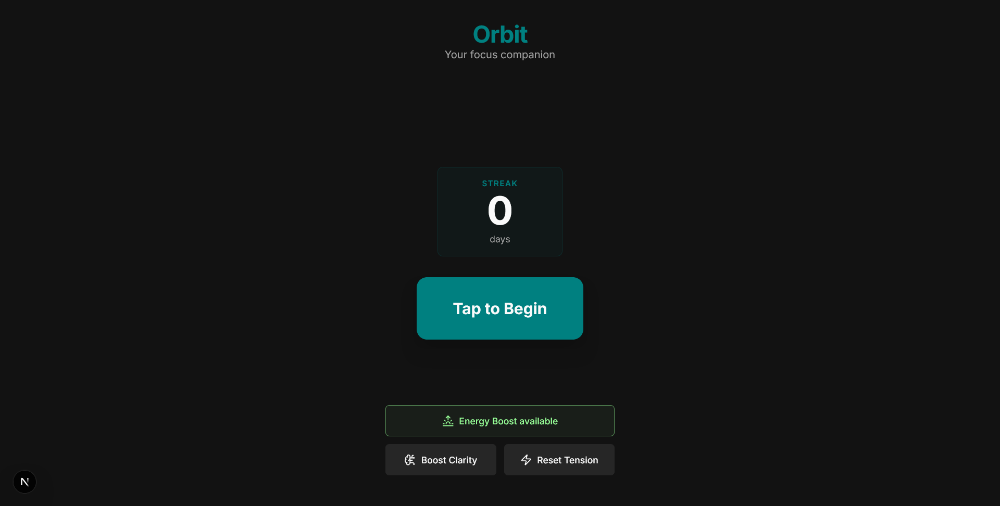

# 🪐 Orbit

**Bridge the gap between executive dysfunction and deep focus.**

Orbit is a minimal, ADHD-first productivity web app designed to help you overcome task initiation paralysis using nervous-system regulation and low-friction micro-sprints.


---

## 🧠 Why Orbit Exists (The Philosophy)

Traditional productivity apps are built for neurotypical brains. They assume you can simply pick a task from a massive to-do list, set a 25-minute Pomodoro timer, and start working. 

For an ADHD brain, staring at a 25-minute block on a hard task triggers the **"Wall of Awful"**—an emotional barrier of overwhelm, anxiety, and avoidance. Conversely, when under-stimulated, the brain lacks the dopamine and physiological arousal required to initiate action at all.

**Orbit doesn't force focus; it regulates your nervous system first.** By pairing somatic breathing exercises with ultra-short, low-stakes micro-sprints, Orbit lowers the activation energy required to start—letting momentum carry you the rest of the way.

---

## ✨ Key Features

* **🎯 Single-Intent Setting:** Eliminates decision fatigue. Before the timer appears, you declare *one* specific micro-task. No endless backlogs, no clutter.
* **🫁 29-Second Somatic Priming:** A mandatory, guided breathing buffer before every sprint to transition your brain out of paralysis and into a regulated state.
* **⏱️ Momentum Micro-Sprints:** Start with friction-free **3, 5, or 7-minute** intervals. Once you build consistency and complete **10 successful sprints**, you unlock the **20-minute Deep Sprint** mode.
* **⚡ Smart Energy Boost Suggestions:** Orbit monitors context—such as start-of-day sessions, >6 hours of inactivity, or previous "Hard/Distracted" tags—and proactively recommends an energizing breathwork session when your system needs a jumpstart.
* **🪞 Low-Friction Reflective Feedback:** After each sprint, tag your session as **Good**, **Distracted**, or **Hard**. This builds non-judgmental self-awareness and feeds into Orbit's smart energy suggestions.
* **🔥 Visual Daily Streaks:** A clean, encouraging streak counter that rewards consistency without punishing missed days.


---

## 🔬 How It Works: Nervous System Regulation for ADHD

ADHD isn't a deficit of attention; it's a challenge in **regulating** attention and physiological arousal. You are often either *over-aroused* (anxious, overwhelmed, scattered) or *under-aroused* (sluggish, foggy, under-stimulated). 

Orbit uses targeted breathwork mechanics to manually shift your autonomic nervous system into the optimal zone for focus:

### 1. Belly Breathing (Down-Regulation / Calming)
* **Pattern:** `2s Inhale` → `8s Exhale`
* **The Science:** Extended exhalations stimulate the vagus nerve and activate the **parasympathetic nervous system** ("rest and digest"). This lowers heart rate, reduces cortisol, and quiets the anxiety response associated with task overwhelm.
* **When to use:** During your mandatory 29-second priming, or whenever a task feels intimidating and triggers avoidance.

### 2. Chest Breathing (Up-Regulation / Activation)
* **Pattern:** `6s Inhale` → `2s Exhale`
* **The Science:** Longer, deeper inhalations paired with brief exhalations stimulate the **sympathetic nervous system**, increasing heart rate, oxygen uptake, and alertness. It acts as a natural, physiological shot of espresso for an under-stimulated brain.
* **When to use:** First thing in the morning, after long periods of inactivity, or when Orbit detects brain fog and suggests an Energy Boost.

---

## 🛠️ Tech Stack & Architecture

Orbit is built to be fast, lightweight, and distraction-free, relying on modern client-side web technologies:

* **Framework:** [Next.js 15](https://nextjs.org/) (App Router)
* **Styling:** [Tailwind CSS](https://tailwindcss.com/)
* **UI Components:** [Shadcn UI](https://ui.shadcn.com/)
* **Icons:** [Lucide React](https://lucide.dev/)
* **State & Persistence:** Custom React Hooks (`useOrbitData`) and Context (`SprintProvider`) backed by browser `LocalStorage`
* **AI Integration:** [Firebase Genkit](https://firebase.google.com/docs/genkit) (scaffolded for upcoming adaptive coaching and task-breakdown features)

### Under the Hood: High-Precision ISS Timer
Standard JavaScript `setInterval` timers drift or pause when browser tabs become inactive—a major frustration for ADHD workflows. Orbit's `SprintProvider` utilizes an **Interval Since Start (ISS)** calculation anchored to system timestamps. Your timer remains accurate to the millisecond and persists seamlessly across accidental browser refreshes or tab switches.

---

## 🚀 Getting Started

Run Orbit locally on your machine in under two minutes.

### Prerequisites
* Node.js 18.18 or later
* npm, yarn, or pnpm

### Installation

1. **Clone the repository:**
   ```bash
   git clone https://github.com/your-username/orbit.git
   cd orbit
   ```

2. **Install dependencies:**
   ```bash
   npm install
   ```

3. **Start the development server:**
   ```bash
   npm run dev
   ```

4. **Launch Orbit:**
   Open [http://localhost:3000](http://localhost:3000) in your browser, type one small task, take a breath, and begin.

---

## 🔒 Privacy First

Your focus sessions and reflections are personal. 

* **100% Local-Only Storage:** All task intents, sprint histories, streak data, and reflection logs are stored exclusively in your browser's `LocalStorage` via `useOrbitData`.
* **Zero Tracking or Servers:** Orbit has no backend database, no user accounts, no telemetry, and no third-party analytics. Your data never leaves your device.

<!--

## 🗺️ Roadmap

- [ ] **Genkit Micro-Step Decomposer:** Automatically break overwhelming tasks into 3-minute actionable steps using AI.
- [ ] **Ambient Soundscapes:** Integrated brown noise and binaural beats tied to sprint states.
- [ ] **Keyboard-First Navigation:** Full shortcut support to keep hands on the keyboard and minimize context switching.
- [ ] **JSON Data Export/Import:** Backup your streaks and reflection patterns locally.

-->

## 🤝 Contributing

Contributions, ideas, and feedback from the neurodivergent community and developers are warmly welcomed. Please feel free to open an issue or submit a pull request.

## 📄 License

Distributed under the MIT License. See `LICENSE` for more information.
